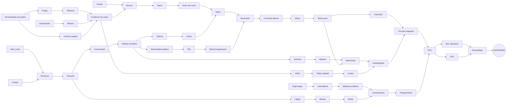

# Árbol tecnológico — "El Libro"

> *"Estimado cliente: el presente manual contiene el 100% del conocimiento necesario para
> la fabricación de un (1) PC gamer. El Departamento no se responsabiliza por plagas,
> guerras tribales ni por la invención accidental de la democracia."*
> — Prefacio del Libro, Formulario 666-B

Este documento es la **columna vertebral** del juego. Cada tecnología es un nodo del
árbol y se **manifiesta** en el mundo de una o más formas: edificio, herramienta,
oficio, recurso, etc. Primero fijamos el árbol completo; después diseñamos cada nodo
en detalle.

**Versión:** 2.0 (borrador: Eras 1–2 consolidadas) · 11 eras · 124 tecnologías · 13 piezas de PC
(ver el [historial de cambios](#9-historial-de-cambios) al final)

---

## 1. Cómo funciona una tecnología

### Estados de un nodo en el Libro

| Estado | Cómo se ve en el Libro | Cómo se llega |
|---|---|---|
| **Sellada** | Página borrosa, en "idioma infernal" | Su era aún no se abre |
| **Legible** | Se lee el título y el dibujo, pero el texto está tachado | La era está abierta, pero faltan prerrequisitos |
| **Estudiable** | Página clara con costo visible | Se cumplen todos los prerrequisitos |
| **Comprendida** | Sello de "APROBADO" del Departamento | Se pagó la **Comprensión** (y recursos, si aplica) |
| **Dominada Nv1–5** | Estrellas en la esquina de la página | Los aldeanos la **practican**, usando el edificio, la herramienta o el oficio |

### Dos monedas de progreso

- **Comprensión** (global): la generan los "pensadores" de cada época y se gasta para
  pasar una página de *Estudiable* a *Comprendida*.
- **Maestría** (por oficio o tecnología): la ganan los aldeanos **haciendo** el trabajo.
  Desbloquea mejoras y manifestaciones de nivel superior. Por ejemplo, *Bronce Nv1*
  permite construir el horno y *Bronce Nv3* mejora las herramientas de todos.
  **Techo de maestría:** ningún oficio pasa de **Nv3** hasta que existen los
  **M05 Gremios**, que desbloquean Nv4 y Nv5.

### Fuentes de Comprensión por era (escalera de pensadores)

**El niño (tocar el Libro)** → Anciano (P01) → Chamán (P11) → Escriba (B06) →
Filósofo (H05) → Profesor (M04) → Científico (R02) → Ingeniero (I03) →
Investigador (X02) → Programador (X10)

**Tocar el Libro** es la mecánica activa del inicio: cada toque es el niño explicándole
el Libro a la tribu y da un poco de Comprensión. Resuelve el arranque, porque al
principio no hay ningún pensador. El toque nunca desaparece, pero los pensadores lo
superan rápido. Más adelante, algunas tecnologías o tratos pueden mejorar el toque.
La primera es **R01 Imprenta**: las copias de bolsillo del Libro **multiplican el toque**,
porque ahora toda la tribu lee a la vez.

### Escala de tiempo

- **1 minuto real ≈ 10 años de juego** (1 año ≈ 6 segundos).
- Un aldeano vive **5–8 minutos reales** (50–80 años). Se empieza con 50 años y cada
  paso médico suma 10:

  | Tecnología | Esperanza de vida | Tiempo real |
  |---|---|---|
  | *(inicio)* | 50 años | 5 min |
  | H10 Medicina clásica | 60 años | 6 min |
  | R11 Higiene y vacunas | 70 años | 7 min |
  | I13 Alcantarillado | 80 años | 8 min |

  El curandero (N11 Aldea organizada) no alarga la vida: solo reduce las muertes por enfermedad.
- **Etapas de la vida:**
  - **Niño:** 0–12 años (72 s). No trabaja.
  - **Adulto:** trabaja en su oficio.
  - **Anciano:** el **último 20% de la vida** (no una edad fija, para que con 80 años
    de vida no haya ancianos durante 40). Deja el trabajo físico y genera Comprensión.
    Con **M07 Lentes**, además sigue trabajando en oficios de precisión (vidriero,
    escriba, relojero).
- **Sin día/noche ni estaciones.**
- El tiempo de juego no sigue la historia real: cada era dura lo que el ritmo pida, no
  lo que duró en la realidad.
- **Progreso offline:** el tiempo sin jugar rinde al **50%**. Con **X13 Almacenamiento
  magnético** (*"respaldo automático"*) pasa a rendir el **100%**. Falta definir cómo se
  resumen las generaciones que pasan mientras no juegas.

### Conservación del saber (mecánica clave)

Los aldeanos envejecen y mueren. **Antes de la Escritura**, cuando muere un maestro se
pierde parte de la maestría de su oficio. Cada hito posterior mejora la transmisión.

> ⚠️ Con vidas de 5–7 minutos, la maestría tiene que subir en **minutos**, no en horas.
> Propuesta: la maestría se guarda **por tecnología a nivel tribu**. Los individuos
> la hacen crecer mientras trabajan, y la muerte de un maestro antes de la Escritura le
> resta un porcentaje. Así, que la gente muera rápido no castiga demasiado y la pérdida
> de saber se sigue notando.

| Tecnología | Efecto sobre la transmisión |
|---|---|
| N09 Conteo y tradición oral | Se pierde **menos** maestría cuando muere un maestro (los ancianos la cuentan junto al fuego) |
| B06 Escritura | La maestría deja de perderse con la muerte (queda en el Archivo) |
| M05 Gremios | Desbloquean la maestría **Nv4–5** (hasta entonces el techo es Nv3) |
| R01 Imprenta | Todos los aldeanos aprenden oficios más rápido |
| I12 Escuela pública | Los niños estudian (dan Comprensión) y entran a su primer oficio **sin período de aprendizaje** |
| D09 Internet | Bonus global de aprendizaje (y memes) |

### Reemplazo generacional y Jefatura

Con 20 habitantes que viven unos 6 minutos, muere alguien cada ~18 segundos. Reasignar
oficios a mano a ese ritmo sería un castigo. La solución es la **Jefatura**.

- **Sin herencia** (playtest 3): los niños llegan a adultos **libres**. La herencia por
  familia concentraba a toda la tribu en una sola categoría.
- **Antes de la Jefatura** todo es manual: + y − por categoría, y los especialistas se
  asignan tocando su edificio. Los libres ayudan a construir.
- **Con N11 Aldea organizada aparece la Jefatura:** "alguien decide por uno". En vez de
  contar personas, dices qué te importa:
  1. **Especialidades (puestos fijos, elegidos por el jugador):** una lista de
     especialidades (chamán, alfarero, tejedor, pastor, curandero…), cada una con
     **"ocupación total"** o una **cantidad** elegida. **No se llenan todas por defecto.**
     Las parcelas y el muelle no están en esta lista: los ocupa la gente de Comida.
  2. **El resto se reparte con la regla de Zipf** según el orden de prioridades que
     elige el jugador: la 1.ª categoría pesa 1, la 2.ª ½, la 3.ª ⅓… (por ejemplo, con 3
     categorías activas: 55%, 27%, 18%).
  3. **Nadie va a donde no hay trabajo:** una categoría sin trabajo se salta y su parte
     se reparte entre las demás (Construcción sin planos, Materiales con los almacenes
     llenos, Comida resuelta más allá de los puestos de parcelas y muelle).
  - **Sin emergencia automática de comida:** enfrentar una hambruna es tarea del jugador.
  - El jefe reasigna **de a una persona por vez** y nunca a alguien que va cargando algo.
- **Tareas manuales:** si el jugador toca un aldeano y le da una tarea, ese aldeano
  queda **fuera de la Jefatura** (sirve para emergencias: tocar varios rápido y mandarlos
  a algo). Al final del panel de la Jefatura aparece la lista **"Con tarea manual"**, con
  un botón para **devolver** a cada uno (o a todos) a la línea de trabajo de la Jefatura.
- **Cambio de oficio:** cuando un aldeano cambia de oficio pasa por un período de
  **aprendizaje** con productividad reducida. **R01 Imprenta** lo acorta mucho (hay
  manuales para todo), así que desde ahí redistribuir a la tribu entre oficios es
  rápido y barato. *(Todavía no implementado en el prototipo.)*

### Genios (incidental)

De vez en cuando nace un aldeano con **talento** en un área (óptica, mecánica,
química…). Si trabaja en el edificio que corresponde, produce un **¡Eureka!**: avanza
gratis una parte del estudio de una página relacionada.

- Es una mecánica **incidental**: aparecen pocas veces, sin sistemas propios para
  atraerlos ni gestionarlos. Es una sorpresa agradable, no algo que se optimiza.
- Tienen nombres parodia (*Isaac Manzana*, *Leonardo da Vinchi*, *Galileo
  Galileísimo*) y La Crónica los registra.
- Pueden aparecer desde la Era 4, pero el Renacimiento es su edad de oro.

### Interfaz que evoluciona

El jugador **ve el juego como lo ve su civilización**:

| Tecnología | Qué cambia en la interfaz |
|---|---|
| *(inicio)* | Los recursos no aparecen como números sino como *"pocos / algunos / muchos / montones"* |
| N09 Conteo | **Números exactos** |
| R07 Calculadora mecánica | **Panel de estadísticas**: producción por minuto y consumos |
| E06 Telégrafo | **Notificaciones de las zonas que no estás mirando** ("se acabó el mineral en la Cueva") |
| X01 Computadora de válvulas | **Predicciones y alertas** ("te quedarás sin carbón en 3 minutos") |
| X14 Redes de computadoras | **Mapa general**: construir y gestionar cualquier zona sin entrar a ella |

Esto se suma a la idea de que el estilo visual de la interfaz cambie por era (tablilla
→ pergamino → papel → CRT → interfaz gamer).

### Oficios por categoría (playtest 2)

Tener muchos oficios sueltos confundía: no se sabía qué hacía cada uno ni cuándo había
aparecido. Ahora los aldeanos se asignan a **pocas categorías amplias**, y las
tecnologías **mejoran cómo trabaja cada categoría**, sin reasignar a nadie (*"el Libro
dice qué, la gente aprende cómo"*).

| Categoría | Qué hace | Cómo mejora con las tecnologías |
|---|---|---|
| 🍖 **Comida** | Consigue comida con el **mejor método disponible** | bayas → caza (P05) → pesca en el muelle (N10) → parcelas (N01) |
| 🧱 **Materiales** | Junta **el material que más falta** | ramas, piedra y fibras → madera (P02) → pigmento (P11) → arcilla (N03) |
| 🔨 **Construcción** | Levanta los planos | aparece con P06 Refugio |
| *(futuro)* 💡 Saber, 🏭 Producción… | | |

- **Especialistas:** los edificios que necesitan a alguien (círculo del chamán, horno,
  telar, corral, huerto) tienen **puestos**. Se asignan **tocando el edificio**. En el
  mapa cada edificio muestra sus puestos como puntos: **llenos = ocupados, vacíos =
  falta gente**. Así, mirando el mapa se entiende en qué está cada persona.
- Las parcelas y el muelle también muestran sus puestos, pero los ocupa sola la gente
  de Comida.
- **Sin categoría:** ayudan a construir a media velocidad, o dan vueltas.

**Regla de diseño:** cada tecnología tiene que producir un **cambio que se vea** (en el
mapa, en la barra o en lo que hace una categoría). Por eso las Eras 1 y 2 pasaron de 12
a 6 tecnologías cada una, y el resto de las eras se consolidará igual (unas 5–7 por era).

**Tarjeta de novedad:** al estudiar una tecnología aparece una tarjeta corta que dice
qué cambió y qué hacer con eso (*"¡Caza! Tu gente de Comida ahora va a la manada…"*).

### Ánimo (único valor global de felicidad y orden)

- **Multiplica** la productividad y la natalidad.
- **Baja** cuando crece la población (hacinamiento y desorden).
- **Lo suben** el arte (P11), la Fogata (P04), las Leyes (B13), la religión y, mucho
  después, la Radio y la TV.
- Todo lo que en el árbol dice "felicidad" u "orden" se refiere a este valor.

### Cadenas de producción y adyacencia

- **Edificios transformadores:** desde la Era 3, muchos edificios reciben un material y
  entregan otro, por ejemplo Madera → Carbonera → Carbón vegetal.
- **Bonos por adyacencia** en la grilla (como en Reactor Idle). Ejemplos:
  - Una **parcela junto a un canal** de Irrigación produce más.
  - Un **horno junto a la carbonera** consume menos combustible.
  - Los canales se colocan casilla por casilla desde el río, así que su trazado es un
    pequeño puzzle.

### Recursos resueltos (autosuficiencia)

Con el tiempo, vigilar todos los recursos se vuelve agotador y quita atención a las
tecnologías nuevas. Por eso cada recurso básico tiene un **nivel máximo**: quedar
**resuelto**.

- **Regla:** mientras tengas **X edificios** con **Y aldeanos asignados de forma fija**
  (y la tecnología correspondiente), el recurso **deja de tener cantidad**: se muestra
  como **"✅ resuelto"**, nunca falta y no tiene límite, **sin importar cuánto crezca la
  población**.
- La infraestructura es **fija**, no proporcional a la población.
- Los aldeanos asignados **siguen ocupados** en esa infraestructura (es su costo
  permanente). La Aldea organizada (N11) mantiene la cuota sola.
- Si falta un edificio o un aldeano asignado, el recurso **deja de estar resuelto** (con
  aviso) y vuelve a tener la cantidad que tenía.
- **💡 Comprensión nunca se resuelve:** es la moneda central del juego.
- **Patrón:** un recurso se resuelve unas 2 o 3 eras después de aparecer, así que la
  atención siempre está en lo de la era actual.

**Tabla provisional** (los números se ajustan con playtests):

| Recurso | Tecnología | Edificios (X) | Aldeanos fijos (Y) | Era |
|---|---|---|---|---|
| Comida | B08 Arado + B09 Irrigación | 4 parcelas + 1 granero | 8 agricultores | 3 |
| Ramas, piedra, fibras | B04 Rueda | 1 granero + 1 depósito *(edificio por definir)* | 2 recolectores de cada uno | 3 |
| Arcilla, cerámica | Alfarería Nv2 (torno) | 2 hornos | 2 alfareros + 2 arcilleros | 3–4 |
| Madera | H12 Silvicultura | 3 bosques plantados | 3 leñadores | 4 |
| Carbón vegetal | H12 Silvicultura | 2 carboneras | 2 carboneros | 4–5 |
| Lana, pieles, tela | I03 Fábrica | Fábrica textil | por definir | 7 |
| Cobre, estaño, bronce, hierro | I03 Fábrica + I05 Ferrocarril | Fábricas + estación | por definir | 7 |

> **En el prototipo (Eras 1–2):** como la Era 3 todavía no existe, la comida se resuelve
> con **N01 Granero** + 4 parcelas + 1 granero + 8 agricultores, para poder probarlo.

### Arco de energía

La energía evoluciona en tres saltos. Cada uno hace más potente la automatización y
cambia cómo se distribuye la ciudad:

| Era | Energía | Cómo funciona |
|---|---|---|
| 5 Medieval | **Mecánica** (molinos) | **Local, por adyacencia**: el molino da energía a los edificios vecinos (aserradero, forja, batán), que trabajan más rápido y con menos aldeanos |
| 7 Industrial | **Vapor** | **Balance de energía por zona**: lo que se produce contra lo que se consume, cada segundo. **No se almacena.** Si hay déficit, los edificios trabajan más lento en proporción. Se muestra con una barra |
| 8 Eléctrica | **Electricidad** | Mismo modelo de balance, pero los edificios eléctricos tienen que estar **dentro del radio de un poste** (≈ 3 casillas). Los postes se conectan solos con los que tienen cerca: no se dibujan cables. Lo que ya funciona a vapor sigue funcionando. Con **E04 Corriente alterna**, **todas las zonas comparten un solo balance** |

### Construcción

- Colocar un edificio deja un **plano en la grilla**. Los aldeanos llevan los materiales
  y lo levantan; no es instantáneo.
- **Desde P06 Refugio** existe el oficio **Constructor**, que construye mucho más rápido
  que un aldeano cualquiera. Mientras no haya constructores, cualquier aldeano libre
  ayuda.
- **H02 Geometría** les da ✋ escuadra y compás: los constructores van todavía más rápido.
- **H11 Palanca y polea** permite la 🏗️ **Grúa**, que acelera las construcciones a su
  alrededor (bono por adyacencia).

### Monedas y la Tienda del diablo

- **B10 Comercio** abre la 🏗️ **Tienda del diablo**, un kiosco infernal abierto 24/7
  en el Valle. Al principio funciona por **trueque**: vendes lo que te sobra y compras
  lo que te falta, a una tasa mala.
- **H07 Moneda** pasa todo a **Monedas**: vendes excedentes en la Tienda y recibes
  Monedas, y con ellas compras recursos y **pactos con el diablo**.
- Los **pactos** se pagan con Monedas **más** su cláusula absurda de letra chica. El
  primer pacto (tutorial de la Era 1) es la excepción: es gratis, solo trae la cláusula.
- **R10 Banca** paga interés pasivo sobre las Monedas guardadas.
- **E07 Teléfono:** cada cierto tiempo **el diablo llama** con una **oferta de pacto por
  tiempo limitado**, con descuento. Telemarketing infernal: *"¿Tiene un minuto para
  hablar de su alma? Es broma. Ya la tenemos."*
- **No hay guerras ni ejércitos.** Las amenazas son eventos cómicos: incendios, plagas de
  langostas, una "auditoría sorpresa" del Departamento.

---

## 2. Tipos de manifestación

| Ícono | Tipo | Qué es en el juego |
|---|---|---|
| 📖 | **Saber** | Bonus pasivo, o abre una zona o capítulo del Libro. No ocupa espacio en el mapa |
| 🏗️ | **Edificio / máquina** | Se coloca en la **grilla**. Los aldeanos caminan hasta él para trabajar |
| ✋ | **Herramienta** | Objeto que el aldeano **lleva en la mano**. Cambia su sprite y su rendimiento |
| 👤 | **Oficio** | Nuevo rol asignable a aldeanos, con su propia maestría |
| 📦 | **Recurso** | Nuevo material en el inventario |
| ⚙️ | **Automatización** | Algo que trabaja solo o reduce la microgestión (el corazón idle) |
| 🏛️ | **Institución** | Gestión social: auto-asignación, orden, felicidad, economía |
| 🖥️ | **Pieza del PC** | Llena un espacio de la silueta del PC (la meta final) |
| 🌿 | **Opcional / soporte** | **No** es prerrequisito (ni directo ni indirecto) de ninguna pieza del PC. Sirve para población, comodidad o bonus |

> Muchas tecnologías tienen **varias manifestaciones**. Por ejemplo, *Alfarería* da un
> edificio (horno de barro), un oficio (alfarero), un recurso (cerámica) y una
> herramienta (vasija).

---

## 3. Hitos de era

Para abrir el capítulo de una era hace falta cumplir ciertas tecnologías y un tamaño
de población. ⚠️ *Las poblaciones son provisionales y se ajustarán al trabajar el
ritmo del juego.*

### Población y rendimiento

**No hay cuadrillas:** todos los aldeanos son individuos hasta el final del juego.

- Lo caro para el celular no es *simular* miles de aldeanos como datos (nombre, edad,
  oficio), sino **dibujarlos y calcular por dónde caminan**.
- **Todos se simulan** como datos y tienen su nombre en La Crónica.
- **Solo se dibuja una cantidad máxima por zona** (≈ 100 caminando).
- Desde la Era 7, los **obreros trabajan dentro de las fábricas** (entran y no se ven),
  lo que reduce naturalmente cuántos hay caminando.

| # | Era | Hito de entrada | Tecnologías requeridas | Población ⚠️ |
|---|---|---|---|---|
| 1 | **Piedra** | *(inicio)* | — | 5 |
| 2 | **Neolítico** | "Asentamiento" | P01, P04, P06 | 10 |
| 3 | **Bronce** | "Excedente" | N01, N03, N09 | 30 |
| 4 | **Hierro / Clásica** | "Ciudad-Estado" | B03, B06 | 80 |
| 5 | **Medieval** | "Reino" | H01, H05, H13 | 200 |
| 6 | **Renacimiento** | "Ilustración" | M03, M04, M07 | 400 |
| 7 | **Industrial** | "Revolución" | R01, R02, R05 | 800 |
| 8 | **Eléctrica** | "La Chispa" | I02, I09, I10 | 1.500 |
| 9 | **Electrónica** | "Lo Pequeño" | E01, E04, E10, E12 | 3.000 |
| 10 | **Digital** | "Silicio" | X05, X09, X10 | 5.000 |
| 11 | **Gamer** | "Configuración Mínima" | D01, D04, D06 | — |

### Evaluación de desempeño del diablo

En **cada hito de era**, el diablo aparece para la *"Revisión trimestral de su pacto"*.
Comenta tus números con jerga corporativa (*"su KPI de mortalidad infantil está por
sobre lo esperado, felicitaciones… creo"*) y presenta el **catálogo de pactos** de la
nueva era, que pasan a estar a la venta en la **Tienda del diablo**. Así los pactos
tienen un momento fijo y se convierten en un ritual recurrente. (El primer pacto de la
Era 1 es la excepción: aparece cuando el jugador se traba, como tutorial.)

### Zonas del mapa

El mundo **no es un solo mapa que crece**, sino un conjunto de **zonas separadas**.
Cada zona es su propia grilla, y se desbloquea con una tecnología o un hito.

**Principio:** la tecnología que abre una zona tiene que *tener sentido*. La luz
(Antorcha) abre la Cueva. El transporte (Rueda, que además aumenta la capacidad de
carga) abre zonas lejanas como las Montañas. La orientación (Brújula) abre las Tierras
lejanas. Y así sucesivamente.

- **Ejemplo:** en el Valle inicial se ve la **entrada de una cueva** con un brillo verde
  adentro. Con **N10 Exploración** (la antorcha) la tribu puede entrar. La cueva es una zona
  completamente nueva y, mientras la miras, **no ves lo que pasa afuera**: estás dentro
  de ese mundo.
- **Rendimiento:** solo la zona que se está mirando dibuja aldeanos caminando y
  calcula sus movimientos. Las demás zonas producen con **tasas agregadas**, con el
  mismo modelo que el progreso offline; sus aldeanos siguen existiendo como datos (ver
  *Población y rendimiento*).
- **Aldeanos:** cada aldeano pertenece a **una zona a la vez**. Moverlo a otra zona
  toma un tiempo de viaje.
- **Inventario único con eficiencia de transporte:** todas las zonas comparten un solo
  inventario, pero lo que se produce lejos llega con una pérdida. No hay rutas que
  gestionar a mano.

  | Transporte | Lo que llega desde una zona lejana |
  |---|---|
  | A pie | 40% |
  | B04 Rueda | 60% |
  | I05 Ferrocarril | 100% |

  *(Porcentajes provisionales. Las zonas cercanas, como la Cueva, podrían tener menos
  pérdida.)*
- **Navegación (mobile):** un selector de zonas siempre visible (íconos arriba), con una
  transición al entrar a cada zona (por ejemplo, oscurecerse al entrar a la cueva).

**Zonas candidatas** (propuesta inicial; se ajusta al revisar cada era):

| Zona | Se desbloquea con | Qué tiene |
|---|---|---|
| **Valle** (inicio) | — | Río (arcilla y arena en la orilla), árboles, rocas, bayas, animales, entrada de la cueva |
| **Cueva** | N10 Exploración (Era 2) | Vetas de cobre (se explotan con B01 Minería), pedernal, ocre. Murciélagos |
| **Costa** | N10 Exploración (Era 2) | Pesca |
| **Montañas** | B04 Rueda (Era 3) | **Estaño** (necesario para el Bronce). **Rocas rojas** que todavía no se pueden usar (hierro, Era 4), como pista. Magnetita |
| **Tierras lejanas** | M09 Brújula (Era 5) | Carbón, petróleo, cuarzo de alta pureza |
| **La Fab** (sala limpia) | X07 Sala limpia (Era 9) | Mundo interior, blanco y luminoso, con aldeanos en traje de conejo. **Único lugar donde se pueden construir fotolitógrafos** |

### Ramas de soporte

Al calcular el cierre de prerrequisitos de las 13 piezas del PC sale un dato
importante: **108 de 124 nodos son obligatorios**. El árbol está muy entrelazado. Varias
cosas "sociales" resultan ser prerrequisitos indirectos del PC:

- **N11 Aldea organizada → B13 Leyes → M04 Universidad / M05 Gremios → … → CPU**
- **N01 Agricultura → B09 Irrigación → M01 Molino → M03 Papel → R01 Imprenta**
- **R11 Higiene → X07 Sala limpia** (*"Bañarse ahora es obligatorio."*)

Solo **16 nodos 🌿 son opcionales**: medicina, silvicultura, catedral, escuelas, alcantarillado,
TV, etc. No bloquean el PC directamente, pero sin ellos cuesta alcanzar la población
de los hitos (mortalidad, hambre, desorden). Es la tensión cómica del juego:
*"¿por qué tengo que inventar el alcantarillado para tener una GPU?"*

> **Para discutir:** ¿queremos más ramas realmente opcionales (rutas alternativas,
> bonus fuertes) o está bien que casi todo sea obligatorio, como en una campaña lineal?

---

## 4. El árbol, era por era

### Era 1 — Piedra
*Recursos nuevos: Comida, Ramas, Piedra, Fibras, Carne, Pieles, Pigmento*
> *"Nivel de tecnología actual: palo. Distancia a un PC gamer: muchísima."*

#### Estado inicial

- **5 aldeanos** con nombre y edad: dos adultos jóvenes, un adulto, un adolescente y un
  niño. **Ningún anciano**, así que la única fuente de Comprensión es tocar el Libro.
- Tienen solo **manos y ropa** (taparrabos).
- **Mapa:** grilla pequeña en vertical (≈ 8×12) con río, árboles, rocas y arbustos de
  bayas. Hay una **cueva oscura con un brillo verde adentro**, como pista de lo que
  viene (*"¿y esa piedra verde?"*). No se puede entrar hasta tener N10 Exploración.
- **Acciones a mano, sin tecnología:** recolectar bayas, ramas y piedras sueltas.
- **Antes del Lenguaje solo se puede señalar:** tocas un aldeano, tocas un objetivo, y
  hace **un solo viaje**. Nada se repite solo.

Las 12 tecnologías originales se fusionaron en **6**, para que cada página del Libro
produzca un cambio que se note (ver *Oficios por categoría*).

| ID | Tecnología | Requiere | Se manifiesta como | Qué aporta |
|---|---|---|---|---|
| P01 | Lenguaje | — | ⚙️ · 📖 · 👤 Anciano | **Primera automatización**: aparecen los **oficios por categoría** (🍖 Comida, 🧱 Materiales) y cada aldeano repite su tarea en bucle. Los ancianos generan Comprensión. *"¿Cómo le explico 'leñador' a alguien que solo dice ugh?"* |
| P02 | Herramientas de piedra | — | ✋ Lasca, hacha, cesta · 📦 Madera | *(Piedra tallada + Cuerda + Hacha + Cestería)*. **Todos recolectan más rápido y cargan el doble.** La gente de Materiales empieza a juntar **madera** |
| P04 | Fuego | P02 | 🏗️ Fogata | Punto de reunión: Ánimo y natalidad ↑, los ancianos se juntan alrededor. **Nv2 = Cocina**: la comida rinde ×1,5 |
| P05 | Caza | P02 | ✋ Lanza · 🏗️ Trampa · 📦 Pieles | *(Lanza + Trampas + Abrigo de pieles)*. **La gente de Comida empieza a cazar** en la manada (más comida, y pieles). **Trampa**: comida pasiva, sin nadie. Abrigo: mortalidad ↓ y Ánimo ↑ |
| P06 | Refugio | P02 | 🏗️ Choza de ramas · 👤 Constructor | Capacidad de población. Aparece la categoría **🔨 Construcción**: levanta edificios mucho más rápido |
| P11 | Arte y ritos | P01, P04 | 🏗️ Pared pintada, Círculo de piedras · 👤 Chamán · 📦 Pigmento · 🖥️ (contorno del PC) | *(Pigmentos + Chamanismo)*. Ánimo ↑. **Chamán** (especialista del Círculo): mucha Comprensión. Materiales junta pigmento. **El niño dibuja el contorno del PC** en la pared. *"El primer RGB de la historia."* |

#### Primer trato con el diablo (tutorial)

La primera vez que el jugador se traba, aparece el diablo:
> *"Fuego. Gratis. Solo firme aquí."*

El precio es absurdo pero inofensivo, por ejemplo: *"Su mamá le dirá 'mijito' frente a
sus amigos. Una vez. Sin aviso."* Enseña la mecánica de los tratos y es el primer
chiste fuerte.

#### Primeros 10 minutos (objetivo de ritmo)

1. Escena inicial: la tienda, la noche, el contrato. Unos 60 segundos y se puede saltar.
2. Cinco personas que gruñen. Tocas el Libro y sube la Comprensión.
3. Señalas aldeanos para recolectar a mano, viaje por viaje.
4. **Lenguaje**: aparecen los oficios y los aldeanos trabajan solos. Primer "¡ahh!".
5. Herramientas de piedra: los aldeanos empiezan a llevar herramientas en la mano.
6. **Fuego**: colocas la Fogata y la tribu se reúne alrededor.
7. Caza, Refugio, nace el primer bebé.
8. Muere el primer aldeano (el adulto, a los ~5 minutos) y se nota la pérdida de saber.
9. Aparece el diablo con su primer trato.
10. Hito "Asentamiento": se abre el capítulo del Neolítico.

### Era 2 — Neolítico
*Recursos nuevos: Grano, Pan, Arcilla, Cerámica, Lana, Leche, Tela, Pescado*
> *"Felicitaciones: su tribu ha descubierto que quedarse quieta es más cómodo."*

La tribu **deja de vagar y se instala**. Es la era de pasar de *recolectar* a *producir*.

#### Mecánicas que introduce esta era

- **Techo natural:** los recursos silvestres (bayas, animales) **se agotan y se
  regeneran lento**. La naturaleza del Valle alimenta como máximo a unas **12–15
  personas**. La Agricultura rompe ese techo, y por eso el hito de la Era 3 pide 30.
- **Almacenamiento con límite:** pila en el suelo (poco) → **vasijas** (N03 Alfarería)
  → **Granero** (N01). Sin descomposición de comida.
- **Arcilla:** se recolecta en la **orilla del río** del Valle. La posición del río
  importa para decidir dónde construir.
- **Primera zona nueva:** la **Cueva** y la **Costa**, con N10 Exploración (ver *Zonas del mapa*).

Las 12 tecnologías originales se fusionaron en **6**.

| ID | Tecnología | Requiere | Se manifiesta como | Qué aporta |
|---|---|---|---|---|
| N01 | Agricultura | P02 | 🏗️ Parcela, Granero · 📦 Grano | *(Agricultura + Granero)*. **Rompe el techo natural**: la gente de Comida trabaja las parcelas. Granero: almacenamiento ↑ y punto de entrega. **Nv2 = Pan** |
| N02 | Ganadería y tejido | P05 | 🏗️ Corral, Telar · 👤 Pastor, Tejedor · 📦 Lana, Tela | *(Domesticación + Tejido)*. Especialistas: **pastor** (comida y lana) y **tejedor** (lana → tela). Raíz lejana de las tarjetas perforadas |
| N03 | Alfarería | P04, P06 | 🏗️ Horno de barro, Casa de adobe · 👤 Alfarero · 📦 Arcilla, Cerámica · ✋ Vasija | *(Alfarería + Adobe)*. **Vasijas: almacenamiento ↑.** Materiales junta **arcilla** en la orilla. **Alfarero** (especialista del horno). Casa de adobe: +6 de capacidad. **Nv2 = Torno** |
| N09 | Conteo y tradición oral | P01, N01 | ✋ Palitos de conteo · 📖 | *(Conteo + Tradición oral)*. **Números exactos en la interfaz** (antes: "pocos / muchos") y se pierde menos maestría al morir un maestro. Raíz de la matemática y de la Escritura. *"Contar el grano antes de que alguien se lo coma."* |
| N10 | Exploración | P02, P04 | ✋ Antorcha · 🏗️ Muelle · 👤 Pescador | *(Antorcha + Balsa y pesca)*. **Abre la Cueva y la Costa.** Muelle: la gente de Comida pesca. *"Ahora podemos ver a los murciélagos. No sé si eso es mejor."* |
| N11 | Aldea organizada | P11, N01 + pob. 15 | 🏛️ · ⚙️ · 🏗️ Huerto medicinal · 👤 Curandero | *(Jefatura + Herbolaria)*. **Jefatura**: eliges especialidades y prioridades, y la tribu se reparte sola (Zipf). **Curandero** (especialista del huerto): enfermedad ↓ |

### Era 3 — Bronce
*Recursos nuevos: Carbón vegetal, Mineral de cobre, Estaño, Cobre, Bronce, Arena, Vidrio, Ladrillo*
> *"Su tribu ha descubierto el metal. El Departamento le recuerda que el metal también
> sirve para hacer armas. Por favor, no."*

#### Mecánicas que introduce esta era

- **Primera cadena de producción de tres pasos** (ver *Cadenas de producción y
  adyacencia*):
  > Madera → **Carbonera** → Carbón vegetal
  > Mineral de cobre + Carbón vegetal → **Horno** → Cobre
  > Cobre + Estaño → **Herrero** → Bronce
- La **madera pasa a ser un recurso disputado** entre construir y quemar, y los árboles
  tienen techo natural.
- **Bonos por adyacencia** (canales, hornos junto a la carbonera).
- **Segunda zona nueva:** las **Montañas** (Rueda), con el estaño y la pista del hierro.
- **La Crónica** (con la Escritura): un registro de aldeanos notables, como el primero
  que fundió cobre, el más longevo o el que murió de forma ridícula. Le da sentido a
  que cada aldeano tenga nombre, aunque viva 6 minutos.

| ID | Tecnología | Requiere | Se manifiesta como | Qué aporta |
|---|---|---|---|---|
| B01 | Minería | P02, N10 | 🏗️ Mina (sobre vetas de la Cueva o de las Montañas) · 👤 Minero · ✋ Pico | Acceso a minerales |
| B02 | Fundición de cobre | N03, B01, B05 | 🏗️ Horno de fundición · 👤 Fundidor · 📦 Cobre | **Cobre: el metal del PC.** Consume carbón vegetal |
| B03 | Bronce | B02, B04 | 👤 Herrero · 📦 Bronce · ✋ Herram. de bronce | Mejora todas las herramientas. Necesita el estaño de las Montañas |
| B04 | Rueda | P02, N02 | ✋ Carretilla · ⚙️ | Los aldeanos cargan más y caminan más rápido con carga. **Abre la zona Montañas** |
| B05 | Carbón vegetal | P04, P02 | 🏗️ Carbonera · 👤 Carbonero · 📦 Carbón vegetal | Combustible para los hornos. *"Quemar árboles para hacer piedras brillantes. Tiene lógica."* |
| B06 | Escritura | N09, P11 | 👤 Escriba · 🏗️ Archivo de tablillas | **El saber ya no muere con los maestros.** Abre **La Crónica** |
| B07 | Ladrillo cocido | N03, B02 | 🏗️ Edificios de ladrillo · 📦 Ladrillo | Mejora edificios y hornos más calientes |
| B08 | Arado 🌿 | N01, N02, B03 | ✋ Arado con bueyes | Comida ↑↑ |
| B09 | Irrigación | N01, B01 | 🏗️ Canal (casilla por casilla desde el río) | **Bono por adyacencia**: las parcelas junto a un canal producen más. Agua para máquinas futuras |
| B10 | Comercio | B04, N09 | 🏗️ Tienda del diablo | **Abre la Tienda del diablo**: trueque de excedentes por lo que falta, a una tasa mala. *"Atendemos 24/7. Literalmente para siempre."* |
| B11 | Vidrio primitivo | B02 | 📦 Arena, Vidrio | Usa arena de la orilla del río. Raíz del monitor, las lentes y el silicio |
| B12 | Astronomía | B06, N09 | 📖 · 🏗️ Piedras alineadas (varias casillas) | Comprensión ↑. **Primer edificio grande**, tarda en construirse. *"Nadie sabe para qué sirve. Se ve imponente."* |
| B13 | Código de leyes | B06, N11 | 🏛️ | Reduce cuánto baja el **Ánimo** al crecer la población |

### Era 4 — Hierro / Clásica
*Recursos nuevos: Mineral de hierro, Hierro, Monedas, Vidrio claro, Magnetita, Engranajes*
> *"Su aldea ha sido reclasificada como 'ciudad-estado'. Esto no cambia nada, pero
> suena mejor en los informes."*

La aldea pasa a ser **ciudad**: hierro, filosofía, dinero y edificios grandes.

#### Mecánicas que introduce esta era

- **Cadena del hierro:** Mineral de hierro (las rocas rojas de las Montañas) + Carbón
  vegetal → **Forja** → Hierro. Esto **duplica la demanda de carbón vegetal** y presiona
  el techo natural de la madera, que se resuelve con **H12 Silvicultura**.
- **Monedas:** la Tienda del diablo pasa del trueque a las Monedas, y con ellas se
  compran pactos (ver *Monedas y la Tienda del diablo*).
- **Urbanismo:** la grilla del Valle crece (H03).
- **Agua lejos del río:** el Acueducto extiende el puzzle de los canales a todo el mapa.

| ID | Tecnología | Requiere | Se manifiesta como | Qué aporta |
|---|---|---|---|---|
| H01 | Hierro | B03, B07 | 🏗️ Forja · 📦 Hierro · ✋ Herram. de hierro | Metal barato y fuerte. Consume mucho carbón vegetal |
| H02 | Geometría | B12, B06 | ✋ Escuadra y compás · 📖 | **Los constructores van más rápido.** Base de la matemática |
| H03 | Arco y arquitectura 🌿 | H02, B07 | 🏗️ Templo, edificios grandes | **Amplía la grilla del Valle** (por ejemplo, de 8×12 a 10×16) y permite edificios de varias casillas |
| H04 | Acueducto 🌿 | H03, B09 | 🏗️ Acueducto (casilla por casilla) | **Lleva agua lejos del río**: canales y parcelas en cualquier parte |
| H05 | Filosofía | B06, B13 | 👤 Filósofo · 🏗️ Academia | Comprensión ↑↑. Filósofos que caminan en círculos discutiendo: *"Si un árbol cae en el bosque y nadie lo convierte en carbón…"* |
| H06 | Lógica | H05, H02 | 📖 | **Raíz del software.** Aumenta la Comprensión de la Academia. Globos de diálogo con silogismos absurdos: *"Si p entonces GPU."* |
| H07 | Moneda | B10, B03 | 📦 Monedas · 🏛️ | La Tienda del diablo pasa a funcionar con **Monedas**. Se pueden **comprar pactos** |
| H08 | Vidrio soplado | B11, H01 | 🏗️ Vidriería · 👤 Vidriero · 📦 Vidrio claro | Lentes, tubos, matraces y (mucho después) pantallas |
| H09 | Magnetita | B01, H05 | ✋ Piedra imán · 📦 Magnetita | Los aldeanos juegan con ella y eso da un poco de Comprensión. Raíz del magnetismo y la electricidad |
| H10 | Medicina clásica 🌿 | N11, H05 | 🏗️ Casa de salud | **+10 años de vida** (50 → 60) |
| H11 | Palanca y polea | H02, P02 | 🏗️ Grúa | **Acelera las construcciones** a su alrededor (adyacencia) |
| H12 | Silvicultura 🌿 | H01, N01 | 🏗️ Bosque plantado | **Rompe el techo natural de la madera.** *"Plantar árboles para quemarlos. El ciclo de la vida."* |
| H13 | Engranajes | H11, B03 | 🏗️ Noria · 📦 Engranajes | **Noria**: bono de adyacencia fuerte a parcelas y canales. Primera máquina con engranajes; adelanta al Molino |

### Era 5 — Medieval
*Recursos nuevos: Papel, Acero (caro), Lentes*
> *"Aviso: su tribu ha comenzado a rezarle a usted. El Departamento le recuerda que el
> que tiene el contrato soy yo."*

Llegan las **máquinas que trabajan solas** (molinos, reloj) y las instituciones del
saber (universidad, gremios).

#### Mecánicas que introduce esta era

- **Energía mecánica por adyacencia**: primer salto del *Arco de energía*.
- **Techo de maestría Nv3**, que se rompe con los Gremios.
- **Etapas de la vida** con anciano en el último 20% (ver *Escala de tiempo*).
- **Primer proyecto de varias generaciones:** la Catedral.
- **Tono:** la tribu **venera al niño**. El Libro pasa a ser "sagrado", aparecen vitrales
  con su cara y los aldeanos le rezan para pedir cosechas. El diablo está celoso.

| ID | Tecnología | Requiere | Se manifiesta como | Qué aporta |
|---|---|---|---|---|
| M01 | Molino de agua | H13, B09 | 🏗️ Molino (junto a un río o canal) · ⚙️ | **Da energía a los edificios vecinos** (aserradero, forja, batán): trabajan más rápido y con menos aldeanos |
| M02 | Molino de viento 🌿 | H13 | 🏗️ Molino de viento · ⚙️ | Igual que el de agua, pero **más débil**. Se pone en cualquier parte, incluidas las Montañas |
| M03 | Papel | N02, M01 | 🏗️ Papelera · 📦 Papel | La escritura escala |
| M04 | Universidad | H05, M03, B13 | 🏗️ Universidad · 👤 Profesor | Comprensión ↑↑ y especialización más rápida |
| M05 | Gremios | H07, B13 | 🏛️ | **Desbloquean la maestría Nv4–5** (hasta ahora el techo era Nv3) |
| M06 | Reloj mecánico | H13, H01 | 🏗️ Torre del reloj · 👤 Relojero | **Bono de productividad en un radio**: los edificios cercanos "trabajan con horario". *"Primer reloj de CPU: 1 Hz."* |
| M07 | Lentes | H08, H02 | ✋ Anteojos · 📦 Lentes | **Los ancianos siguen trabajando en oficios de precisión.** Raíz de la óptica y la fotolitografía |
| M08 | Alquimia | H08, B02, H05 | 👤 Alquimista · 🏗️ Laboratorio | Intentan hacer oro: **de vez en cuando generan Monedas**. Explosiones cómicas que dañan el laboratorio. Comprensión. Precursora de la química. Diablo: *"Por fin alguien con iniciativa."* |
| M09 | Brújula | H09 | ✋ Brújula | **Abre la zona Tierras lejanas** |
| M10 | Acero de crisol | H01, M08 | 📦 Acero · ✋ Herram. de acero | Acero artesanal y caro. Herramientas de acero: productividad ↑ |
| M11 | Catedral 🌿 | H03, H08 | 🏗️ Catedral (muy grande) | **Proyecto de varias generaciones** (unos 30 min reales) con vitrales. Bono permanente y fuerte al Ánimo. La Crónica registra quién puso la primera piedra y quién la última. *"La terminarán tus tataranietos. Literalmente."* |

### Era 6 — Renacimiento / Científica
*Recursos nuevos: Libros, Ácidos, Sales, Químicos*
> *"El Departamento informa que su tribu ha empezado a hacer preguntas. Esto suele
> terminar mal para nosotros."*

#### Mecánicas que introduce esta era

- **Cadena del conocimiento:** Papel → **Imprenta** → Libros → **Universidad** →
  Comprensión.
- **El toque se multiplica** gracias a las copias del Libro.
- **Cambiar de oficio se vuelve rápido** (ver *Reemplazo generacional*).
- **Interés pasivo sobre las Monedas** (Banca).
- **Panel de estadísticas** (ver *Interfaz que evoluciona*).
- **Edad de oro de los genios** (incidental).

| ID | Tecnología | Requiere | Se manifiesta como | Qué aporta |
|---|---|---|---|---|
| R01 | Imprenta | M03, B03 | 🏗️ Imprenta · 👤 Impresor · 📦 Libros | **Comprensión ↑** (la Universidad consume Libros). **Cambiar de oficio es rápido y barato.** **Multiplica el toque** (copias de bolsillo del Libro) |
| R02 | Método científico | R01, M04, M08 | 👤 Científico · 📖 | **Hito.** Los alquimistas se reconvierten en químicos y se acaba su producción de Monedas: *"La ciencia ha demostrado que el oro no se fabrica. El Departamento está decepcionado."* |
| R03 | Química | R02, M08 | 🏗️ Laboratorio · 👤 Químico · 📦 Ácidos, Sales | Base de los materiales modernos |
| R04 | Cálculo | R02, H02 | 📖 | Física, ingeniería y gráficos 3D (mucho después) |
| R05 | Física clásica | R04, H11 | 📖 | **Molinos ×1,5.** Le cae una manzana a Isaac Manzana (si está vivo, aparece como genio) |
| R06 | Telescopio y microscopio | M07, R02 | 🏗️ Observatorio | Comprensión ↑ y descubrimiento de los gérmenes (se ven sobre los aldeanos, como chiste) |
| R07 | Calculadora mecánica | M06, R04 | 🏗️ Calculadora de engranajes | **Abre el panel de estadísticas.** *"El primer computador. Solo suma. Mal. Pero suma."* |
| R08 | Electricidad estática | R02, H08, H09 | ✋ Botella de Leyden | Aldeanos con el pelo de punta. Raíz de la electricidad |
| R09 | Pararrayos 🌿 | R08, H01 | 🏗️ Pararrayos | Protege del evento "rayo" |
| R10 | Banca 🌿 | H07, R01 | 🏗️ Banco del Departamento · 🏛️ | **Interés pasivo sobre las Monedas guardadas**: ahorrar o gastar en pactos. *"Tasa de interés competitiva. Tasa de condenación: también."* |
| R11 | Higiene y vacunas | R06, R03 | 🏗️ Hospital | **+10 años de vida** (60 → 70). Mortalidad ↓↓↓. Explosión demográfica. **Necesaria para la Sala limpia** |
| R12 | Sistema binario | H06, R04 | 📖 | *"Solo dos números. Revolucionario."* |

### Era 7 — Industrial
*Recursos nuevos: Carbón, Acero industrial, Petróleo, Energía (vapor), Tela de lujo, Tarjetas perforadas*
> *"El Departamento de Recursos Humanos le informa que sus trabajadores han descubierto
> la palabra 'sindicato'. Le deseamos suerte."*

Cambia la **escala**: miles de habitantes, energía de vapor y fábricas.

#### Mecánicas que introduce esta era

- **Energía como balance por zona** (segundo paso del *Arco de energía*).
- **Industrialización:** los edificios artesanales se **mejoran en su lugar** a su versión
  fábrica, que **consume vapor, produce varias veces más y necesita menos aldeanos**
  (obreros, que trabajan dentro y no se ven). Por ejemplo, el herrero pasa a Fábrica de
  herramientas y el telar a Fábrica textil.
- **Logística:** la eficiencia de transporte entre zonas (ver *Zonas del mapa*) llega al
  100% con el Ferrocarril.
- **Cuotas automáticas** con la Máquina analítica.
- **Las Tierras lejanas pasan a ser centrales**: carbón y petróleo.
- **Sin contaminación como sistema**: el humo de las chimeneas es solo visual.
- **Huelgas** como evento cómico si el Ánimo baja mucho.

| ID | Tecnología | Requiere | Se manifiesta como | Qué aporta |
|---|---|---|---|---|
| I01 | Carbón | B01, M09 (+ yacimiento) | 🏗️ Mina de carbón (Tierras lejanas) · 📦 Carbón | Combustible denso para el vapor |
| I02 | Máquina de vapor | I01, R05, M10 | 🏗️ Máquina de vapor · ⚙️ | **Gran salto idle**: quema Carbón y produce **energía**, como balance por zona (no se almacena; el déficit ralentiza) |
| I03 | Fábrica | I02, M05 | 👤 Obrero / Ingeniero · ⚙️ | **Mejora los edificios artesanales a su versión fábrica**: consumen vapor, producen varias veces más y necesitan menos aldeanos |
| I04 | Acero industrial | I02, R03, M10 | 🏗️ Acería · 📦 Acero | Acero barato (gabinete) |
| I05 | Ferrocarril 🌿 | I02, I04 | 🏗️ Vías y estación · ⚙️ | **Lo producido en zonas lejanas llega al 100%** (a pie, 40%; con Rueda, 60%) |
| I06 | Telar de tarjetas | N02, I03, R07 | 🏗️ Telar programable · 📦 Tarjetas perforadas, Tela de lujo | **Tela de lujo** que se vende cara en la Tienda del diablo. *"Primer programa de la historia: un estampado de flores."* |
| I07 | Máquina analítica | I06, R07, R12 | 🏗️ Máquina analítica · ⚙️ | **Cuotas automáticas óptimas**: el juego calcula las cuotas de cada oficio según la demanda. *"En la realidad nunca se terminó. Aquí sí. Tarda 3 días. Se equivoca."* |
| I08 | Pila voltaica | R08, R03 | ✋ Pila · 📦 Baterías | Primera electricidad continua (prerrequisito) |
| I09 | Electromagnetismo | I08, H09, R05 | 📖 | La electricidad mueve cosas (prerrequisito) |
| I10 | Máquinas herramienta | I02, I04 | 🏗️ Taller mecánico · 👤 Maquinista | Piezas de precisión |
| I11 | Petróleo | I01, R03 (+ yacimiento) | 🏗️ Pozo petrolero (Tierras lejanas) · 📦 Petróleo | Se acumula en esta era **como pista**: se usa recién con la Refinería (Era 8). Raíz del plástico |
| I12 | Escuela pública 🌿 | R01 + pob. | 🏗️ Escuela | Los niños estudian (dan Comprensión) y entran a su primer oficio **sin período de aprendizaje** |
| I13 | Alcantarillado 🌿 | H04, R11 | 🏗️ Alcantarillado | **+10 años de vida** (70 → 80). Población ↑↑ |

### Era 8 — Eléctrica
*Recursos nuevos: Electricidad, Cable de cobre, Combustibles, Químicos, Plástico, Aluminio, Válvulas*
> *"El Departamento le recuerda que la electricidad es peligrosa. Lo decimos con
> conocimiento de causa: la inventamos nosotros. (No es cierto.)"*

Tercer paso del arco de energía, y la producción empieza a fabricar los **primeros
materiales del PC**.

#### Mecánicas que introduce esta era

- **Red eléctrica con postes que tienen radio** (≈ 3 casillas) y se conectan solos:
  solo se tocan postes, no se dibujan cables. Los edificios eléctricos tienen que estar
  cubiertos. **Lo que ya funciona a vapor sigue funcionando.**
- **Un solo balance de energía para todas las zonas** desde la Corriente alterna.
- **Notificaciones de otras zonas** (Telégrafo) y **llamadas del diablo** con ofertas
  (Teléfono).
- **La ciudad se llena de luces** cálidas (las bombillas), aunque no haya noche: el
  cambio de era se nota a la vista.
- **Primeros avances de la silueta del PC** con materiales reales (ver sección 5).

| ID | Tecnología | Requiere | Se manifiesta como | Qué aporta |
|---|---|---|---|---|
| E01 | Generador eléctrico | I09, I02 | 🏗️ Central eléctrica · ⚙️ · 📦 Electricidad | Quema **Carbón** o, con más rendimiento, **Combustibles**. **Variante hidroeléctrica** 🌿: junto al río, no consume nada pero produce poco |
| E02 | Cable de cobre | B02, I10, E01 | 🏗️ Trefiladora, postes · 📦 Cable | **Postes con radio que se conectan solos** |
| E03 | Bombilla | E02, H08 | 🏗️ Farolas, luz interior | Productividad ↑ en edificios interiores (fábricas, laboratorios, escuelas). Luces visibles en toda la ciudad. *"Ya no hay excusa para no leer."* |
| E04 | Corriente alterna | E01, E02, R04 | 🏗️ Transformador | **Todas las zonas comparten un solo balance de energía**: puedes generar junto al carbón y consumir en el Valle. Raíz de la fuente de poder |
| E05 | Motor eléctrico | I09, E02 | ⚙️ | Las fábricas pasan a ser eléctricas (más eficientes que a vapor) |
| E06 | Telégrafo | E02, I08 | 🏗️ Estación de telégrafo | **Notificaciones de las zonas que no estás mirando** y cuotas aplicables a todas las zonas a la vez. Raíz de las redes |
| E07 | Teléfono | E06, R05 | 🏗️ Central telefónica | **El diablo llama** con ofertas de pactos por tiempo limitado, con descuento |
| E08 | Refinería | I11, R03 | 🏗️ Refinería · 📦 Combustibles, Químicos | **Combustibles** para las centrales (primer uso del petróleo) y Químicos |
| E09 | Plásticos | E08 | 🏗️ Planta de plásticos · 📦 Plástico | Gabinete, periféricos y placas |
| E10 | Tubo de vacío | E03, I10 | 📦 Válvulas | Primera electrónica |
| E11 | Radio 🌿 | E10, I09 | 🏗️ Antena | Música: Ánimo ↑ |
| E12 | Álgebra de Boole | R12, H06 | 📖 | La lógica se vuelve circuito |
| E13 | Aluminio | E01, R03 | 📦 Aluminio | Disipadores |
| E14 | Rayos catódicos 🌿 | E10, H08 | 🖥️ (avance del Monitor) | **Primer avance visible del Monitor**: una pantallita CRT verde que se enciende en la silueta |

### Era 9 — Electrónica
*Recursos nuevos: Cuarzo, Silicio, Lingotes, Obleas, Transistores, PCB, Chips, Ventiladores, Código*
> *"El Departamento ha detectado que su tribu fabrica cosas que no se pueden ver a
> simple vista. Nos preocupa. Esa era nuestra especialidad."*

El tema de la era es **lo pequeño**: la recta final de la producción, la "fábrica final"
del juego.

#### Mecánicas que introduce esta era

- **Cadena del chip**, la más larga del juego:
  > Cuarzo (Tierras lejanas) → **Horno de arco** → Silicio
  > Silicio → **Cristalizador** → Lingote → (cortado) → **Obleas**
  > Obleas + Químicos → **Fotolitógrafo** (en La Fab) → **Chips**
- **Zona nueva: La Fab** (sala limpia), el único lugar donde se construyen fotolitógrafos.
- **Miniaturización visible:** la computadora se achica en la grilla y libera espacio:

  | Tecnología | Tamaño | Comportamiento |
  |---|---|---|
  | X01 Computadora de válvulas | 4×4 | Se rompe seguido (se queman las válvulas) |
  | X05 Transistor | 2×2 | Ya no se rompe |
  | X09 Circuito integrado | 1×1 | — |
  | D01 Microprocesador (Era 10) | Un PC sobre un escritorio | — |

- **Código:** recurso nuevo que producen los programadores. Se gasta para construir las
  piezas de software (Sistema operativo, Motor de videojuegos, el Juego).
- **Mapa general** (Redes) y **progreso offline al 100%** (Almacenamiento magnético).

| ID | Tecnología | Requiere | Se manifiesta como | Qué aporta |
|---|---|---|---|---|
| X01 | Computadora de válvulas | E10, E12, I07 | 🏗️ Sala de cómputo (4×4) · ⚙️ | Gigante, caliente y **se rompe seguido**. **Predicciones y alertas en la interfaz** |
| X02 | Física cuántica | R05, E10, M04 | 👤 Investigador · 📖 | *"Nadie la entiende. Funciona igual."* |
| X03 | Silicio metalúrgico | E04, B11 (+ cuarzo) | 🏗️ Horno de arco · 📦 Silicio | Cuarzo → silicio |
| X04 | Silicio monocristalino | X03, R03, X02 | 🏗️ Cristalizador · 📦 Lingote, Obleas | Silicio ultrapuro, cortado en **obleas** |
| X05 | Transistor | X02, X04 | 📦 Transistores | **Hito.** La computadora se achica a **2×2** y deja de romperse. *"La cosita que cambió todo."* |
| X06 | Circuito impreso | E09, E02, R03 | 🏗️ Fábrica de PCB · 📦 PCB | Raíz de la placa madre |
| X07 | Sala limpia | X04, R11 | ✋ Traje de conejo | **Abre la zona La Fab.** *"Bañarse ahora es obligatorio. Dos veces."* |
| X08 | Fotolitografía | X07, M07, R03 | 🏗️ Fotolitógrafo (solo en La Fab) | Obleas + Químicos → Chips. Dibujar con luz a escala microscópica |
| X09 | Circuito integrado | X05, X08 | 📦 Chips | Miles de transistores en uno. La computadora pasa a **1×1** |
| X10 | Lenguajes de programación | X01, E12 | 👤 Programador · 🏗️ Oficina · 📦 Código | Los programadores producen **Código** (y algo de Comprensión: último escalón de la escalera de pensadores). *"Escribió 10.000 líneas. 9.000 son comentarios pidiendo perdón."* |
| X11 | Televisión 🌿 | E14, E11 | 🏗️ Antena de TV | Ánimo ↑↑ (y productividad un poco ↓, chiste) |
| X12 | Refrigeración activa | R05, E05 | 📦 Ventiladores | Cooler del PC. **Reduce las fallas de la computadora** mientras haya válvulas |
| X13 | Almacenamiento magnético | H09, X01, E05 | 📦 Cinta, disco | **Progreso offline al 100%** (antes 50%): *"respaldo automático"* |
| X14 | Redes de computadoras | X01, E07 | 🏗️ Nodo de red | **Mapa general**: construir y gestionar cualquier zona sin entrar. Raíz de Internet |

### Era 10 — Digital
*Recursos nuevos: Panel LCD, LEDs*
> *"El Departamento informa que su proyecto está al 54%. Le recordamos que el 46%
> restante es el que suele salir caro."*

Se completan **7 de las 13 piezas del PC**.

#### Mecánicas que introduce esta era

- **Fabricación de piezas:** cada pieza es un proyecto grande y definitivo, hecho en la
  Fab de chips, la Planta de electrónica o la Oficina de software (ver sección 5).
- **Fin de la miniaturización:** la computadora de 1×1 pasa a ser un **PC sobre un
  escritorio**, la imagen de lo que estás construyendo.
- **Digitalización:** se puede poner un PC dentro de cualquier edificio, que gana un
  bono pequeño de productividad.
- **Ironía de la recta final:** los aldeanos también juegan. Llega la notificación:
  *"Los aldeanos dicen que harían lo que fuera por un PC gamer."*

| ID | Tecnología | Requiere | Se manifiesta como | Qué aporta |
|---|---|---|---|---|
| D01 | Microprocesador | X09, X10 | 🏗️ Fab de chips (en La Fab) · 🖥️ **CPU** | **Proyecto de CPU.** La computadora pasa a ser un PC de escritorio. Abre la **digitalización** de edificios |
| D02 | Memoria DRAM | X09 | 🖥️ **RAM** | Proyecto en la Fab de chips |
| D03 | Memoria flash | D02, X13 | 🖥️ **Almacenamiento** | Proyecto en la Fab de chips |
| D04 | Sistema operativo | X10, D01 | 🏗️ Oficina de software · 🖥️ **SO** | Proyecto en la Oficina de software. **Cuesta Código.** *"Requiere reiniciar."* |
| D05 | Gráficos 3D | D01, R04 | 📖 | El Cálculo de hace 5 eras por fin sirve |
| D06 | GPU | D05, D01, X12 | 🖥️ **GPU** | Proyecto en la Fab de chips. **La pieza más cara del juego** |
| D07 | Pantalla LCD | R03, X09, H08 | 📦 Panel LCD | Recurso para el monitor (Era 11) |
| D08 | LED | X05, R03 | 📦 LEDs | Para el monitor, los periféricos… y el RGB |
| D09 | Internet | X14, D04 | 🏗️ Servidor · ⚙️ | **Comprensión ×2** (el saber de la tribu en línea). **Memes:** Ánimo ↑. Necesario para el parche del día uno |
| D10 | Fuente conmutada | E04, X05 | 🖥️ **Fuente de poder** | Proyecto en la Planta de electrónica |
| D11 | Placa madre multicapa | X06, X09 | 🏗️ Planta de electrónica · 🖥️ **Placa madre** | Proyecto en la Planta de electrónica |
| D12 | Motor de videojuegos | D05, D04 | 👤 Desarrollador de juegos | **Cuesta Código.** Los desarrolladores también hacen juegos para los aldeanos: **Ánimo ↑↑, productividad ↓** |
| D13 | Periféricos | E09, D08, M07 | 🖥️ **Teclado y mouse** | Proyecto en la Planta de electrónica. Teclado mecánico, mouse óptico |

### Era 11 — Gamer
> *"El Departamento le informa que su pedido está listo para ensamblar. Le recordamos
> que no aceptamos devoluciones. De nada."*

La última era. **Cascada de piezas que se completan rápido**, una tras otra, como una
vuelta de la victoria. Al final quedan los proyectos grandes: la GPU (si no se terminó
en la Era 10) y **el Juego**, que consume muchísimo Código.

#### El cierre

1. **Ensamblaje (G07):** minijuego táctil de **arrastrar y soltar en el que no se puede
   perder**. Cada pieza se arrastra a su lugar en el gabinete. Si te equivocas de
   orden, solo aparecen chistes:
   > *"Olvidaste los separadores de la placa madre. El aldeano Gonzalo los encontró en su bolsillo."*
   > *"Conectaste el RGB antes que la CPU. El Departamento aprueba tus prioridades."*
2. **Informe final del pacto:** la última evaluación de desempeño del diablo, con un
   resumen de toda la partida sacado de La Crónica: generaciones, aldeanos que
   vivieron, genios, muertes ridículas, pactos firmados y sus cláusulas.
3. **ENCENDER (G08) → final recursivo:** el niño enciende el PC, el juego carga… y es
   **su propia civilización vista desde arriba**. En la aldea, un niño mira al cielo y
   dice *"haría lo que fuera por un PC gamer"*. El diablo aparece a su lado y le guiña
   un ojo. Créditos.

#### Después del final

- **Modo libre:** después de los créditos se puede seguir jugando con la civilización,
  sin objetivos nuevos.
- **Reinicio con prestigio** (opcional): se empieza de nuevo desde la Edad de Piedra y
  **todo rinde ×1,5**. ⚠️ *Por definir: si el bono se acumula con cada reinicio
  (×1,5, ×2,25…) o es fijo.*
- *Idea para conectar con el final:* el reinicio podría contarse como **la historia
  del niño de la aldea** que dijo la frase. El diablo le ofrece el mismo contrato.

| ID | Tecnología | Requiere | Se manifiesta como | Qué aporta |
|---|---|---|---|---|
| G01 | Gabinete con vidrio templado | I04, E09, H08 | 🖥️ **Gabinete** | Proyecto rápido en la Planta de electrónica |
| G02 | Monitor gamer | D07, D08 | 🖥️ **Monitor** | Proyecto rápido en la Planta de electrónica. 144 Hz. El niño llora un poco |
| G03 | Pasta térmica | R03, X12 | 📦 Pasta térmica | Avance parcial de la refrigeración. *"El aldeano Gonzalo usó el tubo entero."* |
| G04 | Disipador y cooler | E13, X12, G03 | 🖥️ **Refrigeración** | Proyecto rápido en la Planta de electrónica |
| G05 | RGB | D08, D04 | 🖥️ **RGB** | Proyecto rápido en la Planta de electrónica. *"+0% de rendimiento. Obligatorio por contrato (cláusula 66.6)."* |
| G06 | El Juego | D12, D09 | 🖥️ **Juego** | **El último proyecto grande**, en la Oficina de software. **Cuesta muchísimo Código.** Descarga un parche de 80 GB el primer día |
| G07 | Ensamblaje |  las 13 piezas | 🏗️ Mesa de ensamblaje | **Minijuego de arrastrar y soltar en el que no se puede perder** |
| G08 | **ENCENDER** | G07 | — | **Informe final del pacto → final recursivo → modo libre** |
| G09 | Refrigeración líquida 🌿 | G04 | — | **Guiño escondido**, sin sistema de logros: tubos con agua de colores burbujeando en el PC. *"Innecesario. Precioso."* |

---

## 5. La silueta del PC (13 espacios)

| Espacio | Tecnología | Era |
|---|---|---|
| CPU | D01 Microprocesador | Digital |
| GPU | D06 GPU | Digital |
| RAM | D02 Memoria DRAM | Digital |
| Almacenamiento | D03 Memoria flash | Digital |
| Placa madre | D11 Placa madre multicapa | Digital |
| Fuente de poder | D10 Fuente conmutada | Digital |
| Sistema operativo | D04 Sistema operativo | Digital |
| Teclado y mouse | D13 Periféricos | Digital |
| Gabinete | G01 Gabinete con vidrio templado | Gamer |
| Monitor | G02 Monitor gamer | Gamer |
| Refrigeración | G04 Disipador y cooler | Gamer |
| RGB | G05 RGB | Gamer |
| Juego | G06 El Juego | Gamer |

### Avances parciales

Las 13 piezas se completan recién en las dos últimas eras. Para que la silueta no pase
casi todo el juego vacía, **cada pieza se ilumina por partes** a lo largo de toda la
partida. Cada avance parcial ilumina una fracción igual de la pieza, y la tecnología
final la completa.

**Avance cero, para todas las piezas:** con **P11 Pigmentos** (Era 1), el niño dibuja el
**contorno del PC** en la pared de la cueva, con pintura rupestre. Desde ese momento la
silueta existe en pantalla, aunque esté vacía.

| Pieza | Avances parciales (en orden) | Se completa con |
|---|---|---|
| **Gabinete** | H01 Hierro (armazón) → I04 Acero industrial (chapa) → E09 Plásticos (frente) | G01 Gabinete con vidrio templado |
| **Fuente de poder** | H09 Magnetita (imán) → I08 Pila voltaica → E02 Cable de cobre → E04 Corriente alterna | D10 Fuente conmutada |
| **Placa madre** | B02 Fundición de cobre → E02 Cable de cobre → X06 Circuito impreso | D11 Placa madre multicapa |
| **CPU** | B11 Vidrio primitivo (arena) → X03 Silicio metalúrgico → X05 Transistor → X09 Circuito integrado | D01 Microprocesador |
| **GPU** | R04 Cálculo (la matemática de los gráficos) → X09 Circuito integrado → D05 Gráficos 3D | D06 GPU |
| **RAM** | N09 Conteo (recordar números) → B06 Escritura (memoria externa) → X09 Circuito integrado | D02 Memoria DRAM |
| **Almacenamiento** | B06 Escritura → M03 Papel → X13 Almacenamiento magnético | D03 Memoria flash |
| **Sistema operativo** | H06 Lógica → R12 Sistema binario → X10 Lenguajes de programación | D04 Sistema operativo |
| **Teclado y mouse** | B06 Escritura (letras) → R01 Imprenta (tipos móviles = teclas) → E09 Plásticos → D08 LED | D13 Periféricos |
| **Monitor** | B11 Vidrio primitivo → H08 Vidrio soplado → E14 Rayos catódicos 🌿 (CRT verde) → D07 Pantalla LCD | G02 Monitor gamer |
| **Refrigeración** | M01 Molino de agua (aspas = ventilador) → E13 Aluminio (disipador) → X12 Refrigeración activa → G03 Pasta térmica | G04 Disipador y cooler |
| **RGB** | P11 Pigmentos (*"el primer RGB de la historia"*) → E03 Bombilla → D08 LED | G05 RGB |
| **Juego** | P11 Pigmentos (arte) → I06 Telar de tarjetas (primer programa) → D12 Motor de videojuegos → D09 Internet (parche del día uno) | G06 El Juego |

**Cuándo empieza a llenarse cada pieza:**

| Era | Primeros avances |
|---|---|
| 1 Piedra | Contorno de todo el PC, RGB, Juego |
| 2 Neolítico | RAM |
| 3 Bronce | Placa madre, CPU, Monitor, Almacenamiento, Teclado y mouse |
| 4 Hierro | Gabinete, Fuente de poder, Sistema operativo |
| 5 Medieval | Refrigeración |
| 6 Renacimiento | GPU |

Así, en la Era 6 todas las piezas ya tienen al menos un avance, y la silueta se va
llenando de forma pareja a lo largo de toda la partida.

### Fabricación de las piezas

Estudiar la página de una pieza **no alcanza**. Después hay que **fabricarla** como un
**proyecto grande que se hace una sola vez**: consume muchos recursos durante un rato
(al estilo de la Catedral, pero más corto) en un edificio específico. Al terminar, la
pieza se completa en la silueta. Así toda la economía construida (chips, cobre,
plástico, código) desemboca en el PC.

| Edificio | Dónde | Piezas que fabrica |
|---|---|---|
| 🏗️ **Fab de chips** | La Fab | CPU, RAM, GPU, almacenamiento |
| 🏗️ **Planta de electrónica** | Valle | Placa madre, fuente de poder, teclado y mouse, monitor, refrigeración, gabinete, RGB |
| 🏗️ **Oficina de software** | Valle | Sistema operativo, el Juego (consumen **Código**) |

> **Completar una pieza es definitivo.** No hay calidades ni hay que rehacerlas: cuando
> una pieza se termina, queda terminada. Así cada pieza completada es un hito con
> todo su peso.

---

## 6. Ruta crítica (vista simplificada)

---

## 7. Resumen de números

| Era | Nodos | Opcionales 🌿 | Nuevos oficios |
|---|---|---|---|
| Piedra | 6 | 0 | Categorías 🍖 Comida, 🧱 Materiales, 🔨 Construcción · Anciano · Chamán |
| Neolítico | 6 | 0 | Pastor, Tejedor, Alfarero, Curandero (especialistas) |
| Bronce | 13 | 1 | Minero, Carbonero, Fundidor, Herrero, Escriba |
| Hierro | 13 | 4 | Vidriero, Filósofo |
| Medieval | 11 | 2 | Relojero, Profesor, Alquimista |
| Renacimiento | 12 | 2 | Impresor, Científico, Químico |
| Industrial | 13 | 3 | Obrero / Ingeniero, Maquinista |
| Eléctrica | 14 | 2 | — |
| Electrónica | 14 | 1 | Investigador, Programador |
| Digital | 13 | 0 | Desarrollador de juegos |
| Gamer | 9 | 1 | — |
| **Total** | **124** | **16** | — |

Los nodos opcionales se concentran en las primeras eras: al principio se construye la
sociedad y al final se construye el PC.

---

## 8. Próximas iteraciones

1. ~~**Revisar el árbol era por era**~~ ✅ Hecho (v0.2 a v1.0).
2. **Ficha detallada por nodo**: costos, efectos numéricos, niveles de maestría, sprite
   de herramienta, tamaño del edificio en la grilla y texto cómico del Libro.
3. **Recursos**: cadena productiva completa (qué edificio convierte qué en qué).
4. **Ritmo**: marco inicial en [02-ritmo.md](02-ritmo.md). Se afina con playtests.
5. ~~**Pasar el árbol a datos**~~ ✅ Hecho: `data/tech-tree.json`, generado desde este documento con `node tools/build-tree.mjs`, más un visor interactivo en `tools/tree-viewer.html` (ver [tools/README.md](../tools/README.md)).
6. **Pendientes que quedaron abiertos en la revisión:**
   - Cómo se resumen las generaciones que pasan mientras no juegas.
   - El catálogo de pactos del diablo: precios en Monedas, cláusulas y efectos.
   - Si el bono del prestigio se acumula con cada reinicio.
   - Los porcentajes de eficiencia de transporte por zona.
   - Las poblaciones exactas de cada hito de era.

---

## 9. Historial de cambios

### v2.1 (borrador) — Playtest 3: la Jefatura
- **Jefatura** (N11): especialidades elegidas por el jugador (ocupación total o cantidad) → reparto Zipf por prioridades → nadie donde no hay trabajo. Sin emergencia automática de comida.
- **Sin herencia de categoría**: los niños llegan a adultos libres.
- **Tareas manuales**: un aldeano con tarea manual queda fuera de la Jefatura hasta que se lo devuelve.
- Demoler edificios (50% de los materiales) y cancelar obras (100%).

### v2.0 (borrador) — Playtest 2: menos tecnologías, oficios por categoría
- **Eras 1 y 2 consolidadas** de 12 a 6 tecnologías cada una (total: 124). Fusiones: P02 ← P03, P07, P08 · P05 ← P09, P10 · P11 ← P12 · N01 ← N07 · N02 ← N05 · N03 ← N06 · N09 ← N04 · N10 ← N12 · N11 ← N08. Las referencias de las demás eras se actualizaron.
- **Oficios por categoría** (🍖 Comida, 🧱 Materiales, 🔨 Construcción) y **especialistas** asignados desde su edificio, con puestos visibles en el mapa.
- **Regla de diseño**: cada tecnología debe producir un cambio visible.
- **Tarjeta de novedad** al estudiar una tecnología.
- **Pendiente**: consolidar las Eras 3 a 11 (5–7 tecnologías por era).

### v1.0 — Revisión de la Era 11 (árbol revisado completo)
- La Era 11 es una **cascada rápida de piezas**, con el Juego como último proyecto grande.
- **G07 Ensamblaje**: minijuego de arrastrar y soltar en el que no se puede perder, con chistes si te equivocas.
- **Informe final del pacto** antes de ENCENDER: resumen de toda la partida con datos de La Crónica.
- **Final elegido: el recursivo (A).** El juego que carga es su propia civilización; un niño de la aldea dice la frase y el diablo le guiña un ojo.
- **Después del final**: modo libre y **reinicio opcional con prestigio** (todo ×1,5).
- **G09 Refrigeración líquida**: guiño escondido, sin sistema de logros.
- Se cierran las 11 revisiones de era. Los pendientes quedan listados en la sección 8.

### v0.11 — Revisión de la Era 10
- **Fabricación de piezas**: estudiar la página no alcanza. Cada pieza es un proyecto grande que se hace una sola vez, en la Fab de chips, la Planta de electrónica o la Oficina de software.
- **Completar una pieza es definitivo**: se descartó la idea de calidades y del puntaje en FPS, para no restarle peso al hito.
- **D04 Sistema operativo, D12 Motor y G06 El Juego** cuestan Código.
- **D09 Internet**: Comprensión ×2 y memes (Ánimo ↑).
- **D12 Motor de videojuegos**: los aldeanos también juegan (Ánimo ↑↑, productividad ↓).
- **D01 Microprocesador**: la computadora pasa a ser un PC de escritorio y abre la digitalización de edificios (bono pequeño).

### v0.10 — Revisión de la Era 9
- **Cadena del chip** explícita, con un recurso nuevo: **Obleas** (Cuarzo → Silicio → Lingote → Obleas → Chips).
- **Zona nueva: La Fab** (sala limpia), abierta por X07. Los fotolitógrafos solo se construyen ahí.
- **Miniaturización visible**: la computadora pasa de 4×4 (válvulas, se rompe) a 2×2 (Transistor) y a 1×1 (Chip).
- **X10 Lenguajes de programación**: los programadores producen **Código**, que se gasta en las piezas de software.
- **X12 Refrigeración activa**: reduce las fallas de la computadora.
- **X13 Almacenamiento magnético**: el progreso offline pasa de rendir el 50% al 100%.
- **X14 Redes**: mapa general para gestionar zonas sin entrar (se suma a la interfaz que evoluciona).

### v0.9 — Revisión de la Era 8
- **Red eléctrica**: postes con radio (≈ 3 casillas) que se conectan solos, sin dibujar cables. Solo se exige a los edificios eléctricos nuevos; lo que funciona a vapor sigue funcionando.
- **E04 Corriente alterna**: un solo balance de energía para todas las zonas.
- **E01 Generador**: quema Carbón o Combustibles (más rendimiento). Variante hidroeléctrica 🌿 junto al río.
- **E06 Telégrafo**: notificaciones de otras zonas (se suma a la interfaz que evoluciona) y cuotas globales.
- **E07 Teléfono**: el diablo llama con ofertas de pactos por tiempo limitado.
- **E08 Refinería**: Combustibles para las centrales.
- **E14 Rayos catódicos**: primer avance visible del Monitor (CRT).
- **Silueta del PC**: tabla completa de avances parciales por pieza. P11 Pigmentos dibuja el contorno del PC; en la Era 6 todas las piezas ya tienen al menos un avance.

### v0.8 — Revisión de la Era 7
- **Población y rendimiento**: se descartan las cuadrillas. Todos los aldeanos se simulan como datos; solo se dibuja un máximo por zona (≈ 100). Los obreros trabajan dentro de las fábricas.
- **Energía**: balance por zona (producción contra consumo), sin almacenamiento; el déficit ralentiza. La electricidad seguirá el mismo modelo con red, y la Corriente alterna enviará energía entre zonas.
- **Logística**: inventario único con eficiencia de transporte entre zonas (a pie 40%, Rueda 60%, Ferrocarril 100%). Se cierra el ⚠️ del inventario.
- **I03 Fábrica**: mejora en el lugar de los edificios artesanales.
- **I06 Telar de tarjetas**: tela de lujo para vender en la Tienda.
- **I07 Máquina analítica**: cuotas automáticas óptimas.
- **I12 Escuela pública**: los niños dan Comprensión y entran sin aprendizaje.
- Sin contaminación como sistema; huelgas como evento cómico.

### v0.7 — Revisión de la Era 6
- **Genios** formalizados como mecánica **incidental**: talento al nacer y Eureka si trabajan en el edificio correcto. Sin Mecenazgo ni sistemas extra.
- **Interfaz que evoluciona**: "pocos/muchos" antes de N09 Conteo → números exactos → panel de estadísticas (R07 Calculadora) → predicciones y alertas (X01 Computadora).
- **R01 Imprenta**: Comprensión ↑ (la Universidad consume Libros), cambiar de oficio pasa a ser rápido y barato, y las copias del Libro multiplican el toque.
- **Cambio de oficio**: período de aprendizaje con productividad reducida, que la Imprenta acorta.
- **R02 Método científico**: se acaba la producción de Monedas de la Alquimia.
- **R05 Física clásica**: molinos ×1,5.
- **R10 Banca**: interés pasivo sobre las Monedas.
- **R09 Pararrayos** se mantiene sin cambios.

### v0.6 — Revisión de la Era 5
- **Arco de energía**: mecánica por adyacencia (Era 5), vapor como recurso (Era 7), red eléctrica (Era 8).
- **M01/M02 Molinos**: dan energía a los edificios vecinos. El de agua va junto a un río o canal; el de viento es más débil y va en cualquier parte.
- **Etapas de la vida**: niño 0–12; adulto; anciano en el último 20% de la vida.
- **M05 Gremios**: desbloquean la maestría Nv4–5 (techo Nv3 antes). Ya no "heredan maestría", porque desde la Escritura no se pierde.
- **M06 Reloj**: bono en un radio. Oficio Relojero.
- **M07 Lentes**: los ancianos siguen trabajando en oficios de precisión.
- **M08 Alquimia**: genera Monedas de vez en cuando.
- **M11 Navegación** se elimina y la reemplaza **M11 Catedral** (proyecto de varias generaciones, Ánimo ↑↑).
- Tono de la era: la tribu venera al niño.

### v0.5 — Revisión de la Era 4
- **Construcción**: los aldeanos levantan los edificios llevando materiales. El oficio **Constructor** sale de **P06 Refugio** (Era 1); Geometría les da escuadra y compás; la Grúa acelera en radio.
- **Tienda del diablo**: B10 Comercio la abre (trueque) y H07 Moneda la pasa a Monedas. **Las Monedas compran pactos.** Desaparecen el Mercado y las caravanas.
- **Sin guerras**: las amenazas son eventos cómicos. **H12 Murallas** se elimina y la reemplaza **H12 Silvicultura** (bosque plantado, rompe el techo de la madera).
- **Esperanza de vida de 50 a 80 años** (5 a 8 min): +10 con H10 Medicina clásica, R11 Higiene e I13 Alcantarillado.
- **H01 Hierro**: cadena con mineral de las Montañas + carbón vegetal.
- **H03 Arco y arquitectura** amplía la grilla del Valle. **H04 Acueducto** lleva agua lejos del río. **H13 Engranajes** se manifiesta como la **Noria**.
- **H05 Filosofía, H06 Lógica, H09 Magnetita**: ahora se ven en el mapa.

### v0.4 — Revisión de la Era 3
- **Mecánicas globales nuevas:** **Ánimo** (único valor de felicidad y orden), **cadenas de producción** con edificios transformadores, **bonos por adyacencia** en la grilla.
- **Evaluación de desempeño del diablo** en cada hito de era, con el catálogo de tratos.
- **Zonas:** se agrega el principio de que la tecnología que abre una zona debe tener sentido. Las Montañas (Rueda) ahora tienen **estaño** y rocas rojas de hierro como pista. La Cueva queda solo con cobre.
- **B05 Torno de alfarero** se elimina como nodo y pasa a ser **Alfarería Nv2**.
- **B05 Carbón vegetal** (nueva): Carbonera, oficio Carbonero. **B02 Fundición** ahora la requiere.
- **B03 Bronce** ahora requiere **B04 Rueda** (estaño de las Montañas).
- **B10 Comercio**: convertidor de excedentes con caravanas.
- **B12 Calendario** pasa a llamarse **Astronomía**: piedras alineadas, primer edificio de varias casillas.
- **B06 Escritura** abre **La Crónica** (aldeanos notables).
- **B13 Leyes**: reduce cuánto baja el Ánimo al crecer la población.
- Total: 136 nodos, 21 opcionales.

### v0.3 — Revisión de la Era 2
- **Zonas del mapa**: el mundo pasa a ser un conjunto de zonas separadas (Valle, Cueva, Costa, Montañas, Tierras lejanas). Solo la zona que se mira simula aldeanos individuales.
- Estado inicial: el cobre visible pasa a ser una **cueva con brillo verde**.
- **N12 Antorcha** (nueva): abre la Cueva. **B01 Minería** ahora requiere N12.
- **N04 Molienda** se elimina como nodo y pasa a ser **Agricultura Nv2 (Pan)**.
- **N04 Tradición oral** (nueva): menos pérdida de saber. **B06 Escritura** ahora la requiere.
- **N11 Jefatura**: cuotas por oficio, requiere 15 habitantes (antes 25).
- **Reemplazo generacional**: los jóvenes heredan el oficio de sus padres desde P01 Lenguaje.
- Mecánicas nuevas: techo natural de recursos silvestres (12–15 personas), límites de almacenamiento (suelo → vasijas → granero), arcilla en la orilla del río.
- N10 Balsa y pesca abre la zona Costa.
- Total: 136 nodos, 22 opcionales.

### v0.2 — Revisión de la Era 1
- Nueva mecánica activa: **tocar el Libro** genera Comprensión (el niño es el primer pensador).
- **P01 Lenguaje** pasa a ser la primera automatización. Antes de él solo se puede señalar (un viaje por orden).
- **P09 Cocina** se elimina como nodo y pasa a ser **Fuego Nv2**.
- **P09 Trampas** (nueva): primer generador pasivo del mapa.
- **P10 Vestimenta de pieles** pasa a llamarse **Abrigo de pieles** (ya empiezan con ropa).
- Se definen el estado inicial, el primer trato con el diablo y los primeros 10 minutos.
- Escala de tiempo: 1 min ≈ 10 años; vida de 5–7 min.
- **Sin día/noche ni estaciones**: se reescriben P04 Fuego, P10 Abrigo, B12 Calendario y E03 Bombilla.

### v0.1 — Borrador inicial
- 11 eras, 135 tecnologías, 13 piezas de PC.
